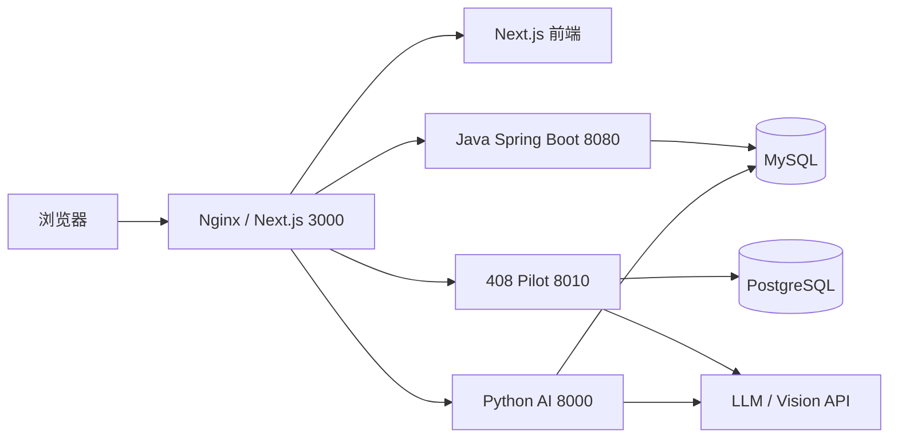

# 408 计算机考研助手

面向 408 计算机学科专业基础综合考研的全流程 AI 学习平台。

项目把课程学习、真题训练、全真模考、错题诊断、变式补练、多模态问答、学习计划、择校分析和内容管理放进同一条学习链路，重点解决四个问题：

- 今天该学什么
- 哪里不会
- 为什么错
- 下一步练什么


## 项目介绍

408 备考通常同时使用视频课、讲义、题库 App、错题本、笔记软件和通用 AI 工具，资料与学习行为彼此割裂。本项目以知识点、题目、作答记录和学习计划为主线，把学习行为统一到一套数据模型中，并由 AI 在关键环节提供辅助。

当前演示数据规模：

| 指标 | 数量 |
|---|---|
| 408 统考真题 | 846 道 |
| AI 练习/变式题 | 2083 道 |
| 题库总量 | 2929 道 |
| 知识点 | 412 个 |
| 408 Pilot 知识点 | 320 个 |
| 408 Pilot 题目 | 2138 道 |
| 知识库切片 | 509 个 |

## 主要功能

- **学习总览**：考研倒计时、目标院校、目标分数、模考统计、错题数量、今日任务、四科掌握度和最近战报。
- **课程中心**：四科章节精讲、公式推导、代码实现、易错点、关联真题、动态演示和随堂助教。
- **智能知识库**：公共/个人资料上传，按文档、切片、页码检索，回答带出处。
- **408 知识图谱**：412 个考点、章节和关联关系可视化。
- **真题训练**：按年份、学科、题型、考点筛选，支持练题模式和练习模式。
- **全真模拟考场**：180 分钟整卷模考，交卷后生成分数、逐题答卷、采分点、薄弱点和 PDF 报告。
- **真题变式题**：基于母题、章节和知识点约束生成，生成后校验题干和选项，失败回退同章节真题。
- **错题本与错题医生**：结合题干、答案、解析、笔记和错误次数做错因诊断，可写入计划、生成变式、标记掌握。
- **多模态问答**：支持多话题上下文、真题截图/结构图粘贴识别、流式输出、引用溯源和 Agent 思考过程。
- **408 全自主闭环备考智能体**：考点精讲 → 针对性自测 → 采分点判分 → 历年真题实战 → 复盘报告。
- **个性化备考规划**：按目标、阶段和真实学习数据生成周任务，自动同步作答、模考、错题和笔记进度。
- **每日补给**：每天推送知识点和配套题，自动判分并回写学习数据。
- **智能择校**：结合目标院校、专业、历史分数和学习准备度，给出冲稳保建议和风险提示。
- **学习分析**：四科雷达、正确率趋势和薄弱考点。
- **考研云笔记**：Markdown、LaTeX、代码高亮、真题/知识库摘录和 AI 摘要。
- **管理端**：用户、题库、公共知识库、全站统计、AI 配置、智能体监控和运维数据。

## 技术架构



| 服务 | 技术栈 | 默认端口 | 职责 |
|---|---|---|---|
| 前端 | Next.js 16 + React 19 + Tailwind CSS 4 | 3000 | 学员端、管理端、课程动画、交互页面 |
| 业务后端 | Java 17 + Spring Boot 4 + MyBatis | 8080 | 认证、题库、考试、错题、笔记、学习计划、统计 |
| Python AI 服务 | FastAPI + PyMySQL | 8000 | RAG、变式题、判卷、错题诊断、多模态解析 |
| 408 Pilot | FastAPI + LangGraph + PostgreSQL | 8010 | 多智能体、混合 RAG、知识图谱、择校、每日补给 |
| 数据库 | MySQL 5.7+ / PostgreSQL 14+ | 3306 / 5432 | 业务数据 / Agent 与学习状态数据 |

## 仓库结构

```text
.
├── mcs-postgrad-helper-web/       # Next.js 前端
├── mcs-postgrad-helper-java/      # Spring Boot 业务后端
├── mcs-postgrad-helper-python/    # FastAPI AI 服务
├── kaoyan/                        # 408 Pilot 多智能体服务
├── database/                      # MySQL / PostgreSQL 建库与数据
├── docs/                          # 作品介绍文档、海报、视频旁白
├── deploy/                        # Nginx 部署示例
├── scripts/start_all.sh           # 本地一键启动
└── README.md
```

## 快速开始

### 0. 环境要求

- Node.js 20+（推荐 22）
- Java 17+
- Python 3.12+
- MySQL 5.7+
- PostgreSQL 14+
- Nginx（生产环境）

### 1. MySQL

```bash
mysql -uroot -p -e "CREATE DATABASE mcs_postgrad_helper DEFAULT CHARACTER SET utf8mb4 COLLATE utf8mb4_unicode_ci;"
mysql -uroot -p mcs_postgrad_helper < database/mysql_dump.sql
```

数据库 dump 已包含表结构和演示数据。`sys_ai_config.api_key` 已清空，启动后可在管理端「AI 引擎与模型配置」中填写自己的 API Key。

### 2. PostgreSQL

```bash
sudo -u postgres createuser --login kaoyan_ai
sudo -u postgres psql -c "ALTER ROLE kaoyan_ai WITH PASSWORD 'change-me';"
sudo -u postgres createdb -O kaoyan_ai kaoyan_ai

psql -h 127.0.0.1 -U kaoyan_ai -d kaoyan_ai -f database/postgres_init.sql
psql -h 127.0.0.1 -U kaoyan_ai -d kaoyan_ai -f database/postgres_auth_upgrade.sql
psql -h 127.0.0.1 -U kaoyan_ai -d kaoyan_ai -f database/postgres_agent_upgrade.sql
psql -h 127.0.0.1 -U kaoyan_ai -d kaoyan_ai -f database/postgres_chat_conversations.sql

cd kaoyan
python -m scripts.import_to_postgres --skip-users
```

### 3. Java 后端

```bash
cd mcs-postgrad-helper-java
export DB_URL='jdbc:mysql://127.0.0.1:3306/mcs_postgrad_helper?serverTimezone=Asia/Shanghai&useUnicode=true&characterEncoding=utf8'
export DB_USER='root'
export DB_PASSWORD='your-password'
./mvnw spring-boot:run
```

也可以打包后运行：

```bash
./mvnw -DskipTests package
java -jar target/*.jar
```

### 4. Python AI 服务

```bash
cd mcs-postgrad-helper-python
python3.12 -m venv .venv
source .venv/bin/activate
pip install -r requirements.txt
cp .env.example .env
# 修改 .env 中的数据库和 JWT 配置
python -m uvicorn main:app --host 0.0.0.0 --port 8000
```

### 5. 408 Pilot

```bash
cd kaoyan
python3.12 -m venv .venv
source .venv/bin/activate
pip install -e .
cp .env.example .env
# 修改 PostgreSQL、JWT 和 LLM 配置
python -m uvicorn kaoyan_ai.api:app --host 0.0.0.0 --port 8010
```

### 6. 前端

```bash
cd mcs-postgrad-helper-web
npm install
npm run dev
```

开发环境由 Next.js rewrites 代理：

```text
/api/*      -> Java 8080
/api/ai/*   -> Python 8000
/ai-api/*   -> Python 8000
/pilot/*    -> 408 Pilot 8010
```

生产环境 Nginx 示例见 `deploy/nginx-408.conf.example`。

## 环境变量

### Python AI 服务

```text
DB_HOST=127.0.0.1
DB_PORT=3306
DB_USER=root
DB_PASSWORD=your-password
DB_NAME=mcs_postgrad_helper
MCS_JWT_SECRET=change-me
INTERNAL_API_TOKEN=change-me
LLM_BASE_URL=https://api.deepseek.com/v1
LLM_MODEL=deepseek-chat
```

### 408 Pilot

参考 `kaoyan/.env.example`，主要配置：

```text
DB_HOST=127.0.0.1
DB_PORT=5432
DB_NAME=kaoyan_ai
DB_USER=kaoyan_ai
DB_PASSWORD=change-me
MCS_JWT_SECRET=change-me
LLM_PROVIDER=openai
OPENAI_API_KEY=your-key
OPENAI_BASE_URL=https://api.deepseek.com/v1
OPENAI_MODEL=deepseek-chat
DATA_DIR=data
SKILL_DIR=skills
```

> 请勿把真实 `.env`、API Key、数据库密码提交到仓库。

## 演示账号

```text
学员：student / 123456
管理员：admin / admin123
```

## 测试命令

```bash
# 前端类型检查
cd mcs-postgrad-helper-web && npx tsc --noEmit

# 前端生产构建
npm run build

# Python 编译
cd mcs-postgrad-helper-python
python -m py_compile main.py routers/*.py services/*.py

# Java 编译
cd mcs-postgrad-helper-java
./mvnw -q -DskipTests compile

# 408 Pilot 测试
cd kaoyan
pytest -q
```

## 文档

- [项目介绍文档（DOCX）](docs/408-project-introduction.docx)
- [项目介绍文档（PDF）](docs/408-project-introduction.pdf)
- [项目海报](docs/poster-408-ai.png)
- [演示视频旁白](docs/video-narration.docx)

## 团队信息

- 团队名称：408 计算机考研助手项目组
- 成员与分工：待补充
- 项目方向：计算机考研 408 全流程 AI 学习系统

## 说明

本项目用于学习、教学与竞赛展示。使用第三方教材、真题图片或模型服务时，请遵守相应版权和服务条款。
